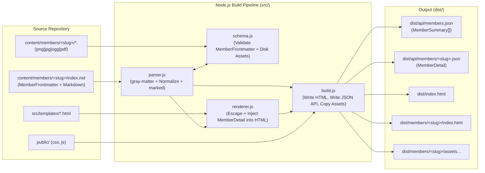

# Technical Design Document: `members.return215.xyz`

## 1. Overview & System Architecture

`members.return215.xyz` is a static site generator (SSG) and static JSON API builder written in Node.js (native ES Modules).
Character profiles ("members") are authored as co-located Markdown directories inside `content/members/<slug>/`. At build time, the Node pipeline reads, validates, normalizes, and compiles each member bundle into:
1. **Static HTML pages**: `dist/index.html` (directory listing) and `dist/members/<slug>/index.html` (member profile).
2. **Static JSON API endpoints**: `dist/api/members.json` ([`MemberSummary[]`](#55-membersummary)) and `dist/api/members/<slug>.json` ([`MemberDetail`](#56-memberdetail)).
3. **Co-located static assets**: `dist/members/<slug>/*.(png|jpg|webp|ogg|pdf)`.

### Runtime & Dependency Constraints
- **Runtime**: Node.js `>=22.0.0`, `"type": "module"`, plain `.js` with JSDoc type references.
- **Third-Party Libraries**:
  - `gray-matter`: YAML frontmatter extraction.
  - `marked`: Markdown-to-HTML compilation.
- **Node Built-in Modules**: `node:fs`, `node:fs/promises`, `node:path`, `node:http`, `node:url`, `node:perf_hooks`, `node:test`, `node:assert/strict`.

---

## 2. Content Modeling Boundary: "Data" (Frontmatter) vs. "Article" (Markdown)

| Dimension | Frontmatter ("Data" — [`MemberFrontmatter`](#41-memberfrontmatter-root-input-object)) | Markdown Body ("Article" — `bodyMarkdown`) |
| :--- | :--- | :--- |
| **Role** | Structured fields that drive UI components (infoboxes, D&D stat blocks, loadout cards, filter tags) and external API consumers. | Narrative prose, biography, combat doctrine, and deep-dive technical/lore explanations. |
| **Validation** | Strictly validated at build time by `src/schema.js` ([`ValidationResult`](#61-validationresult)). Missing required fields or missing files abort the build. | Compiled to HTML via `marked`. Flexible heading structure (`## Biography`, `## Loadout & Vehicles`) per character. |
| **D&D / Tabletop** | Structured [`DndBlockInput`](#48-dndblockinput): Level, Classes, Species, 6 Ability Scores, Combat summary, inline [`ReskinnableFieldInput`](#42-reskinnablefieldinput--reskinobject) mappings, and [`DndSheetsInput`](#412-dndsheetsinput) links. | In-universe narrative context explaining how a curse, birthmark, or martial technique works in lore. |
| **Equipment & Vehicles** | Structured [`EquipmentBlock`](#413-equipmentblock) containing [`LoadoutEntry[]`](#414-loadoutentry) and [`VehicleEntry[]`](#416-vehicleentry) summary cards. | Extended engineering specs, modification logs, and tactical usage notes. |

---

## 3. Constrained Scalar Types

These scalar types are referenced throughout Section 4 (Input Objects) and Section 5 (Normalized Output Objects).

### 3.1 `Slug`
- **Underlying Primitive**: `string`
- **Source**: Derived strictly from the folder name `content/members/<slug>/`.
- **Validation Rule**: Non-empty lowercase alphanumeric kebab-case string matching `/^[a-z0-9]+(?:-[a-z0-9]+)*$/` (or `/^[a-z0-9-]+$/`).

### 3.2 `MemberStatus`
- **Underlying Primitive**: `string`
- **Validation Rule**: Must be one of the exact enum values:
  `"active"` | `"archived"` | `"mia"` | `"classified"` | `"deceased"`

### 3.3 `HexColor`
- **Underlying Primitive**: `string`
- **Validation Rule**: Must be a 3-digit or 6-digit CSS hexadecimal color string matching `/^#([0-9a-fA-F]{3}|[0-9a-fA-F]{6})$/`.

### 3.4 `RelativeAssetPath`
- **Underlying Primitive**: `string`
- **Validation Rule**:
  1. Non-empty relative path string (e.g., `"./avatar.png"` or `"sheet.pdf"`).
  2. When resolved via `path.resolve(memberDir, value)`, the resulting path **must** stay strictly inside `memberDir` (preventing `../` path traversal) and **must** exist on disk as a regular file (`fs.stat`).

### 3.5 `PublicAssetUrl`
- **Underlying Primitive**: `string`
- **Description**: Normalized root-relative URL produced by `src/parser.js` from a [`RelativeAssetPath`](#34-relativeassetpath).
- **Format**: `"/members/<slug>/<relative-path-inside-member-dir>"` (e.g., `"/members/vaelen-vance/avatar.png"`).

### 3.6 `HttpUrl`
- **Underlying Primitive**: `string`
- **Validation Rule**: Valid URL parseable by `new URL(value)` whose `protocol` is strictly `"http:"` or `"https:"`.

---

## 4. Frontmatter Input Object Definitions (Raw YAML)

This section defines every object structure that may appear in a member's `content/members/<slug>/index.md` YAML frontmatter before normalization.

### 4.1 `MemberFrontmatter` (Root Input Object)
The top-level YAML frontmatter object parsed by `gray-matter`.

| Field | Type | Required | Default (in Normalizer) | Description & Constraints |
| :--- | :--- | :--- | :--- | :--- |
| `name` | `string` | **Yes** | — | Non-empty character display name. |
| `role` | `string` | **Yes** | — | Non-empty title, occupation, or unit role. |
| `summary` | `string` | **Yes** | — | Non-empty 1–2 sentence overview for cards and meta tags. |
| `status` | [`MemberStatus`](#32-memberstatus) | **Yes** | — | Current operational status of the member. |
| `group` | `string` | **Yes** | — | Non-empty primary faction, squad, or division name. |
| `tags` | `string[]` | No | `[]` | Array of non-empty lowercase strings used for filtering. |
| `order` | `number` | No | `999` | Finite number (`Number.isFinite`) for default directory sort order. |
| `avatar` | [`RelativeAssetPath`](#34-relativeassetpath) | **Yes** | — | Co-located avatar image file. |
| `banner` | [`RelativeAssetPath`](#34-relativeassetpath) | No | `null` | Optional co-located banner/cover image file. |
| `gallery` | [`GalleryItemInput[]`](#44-galleryiteminput) | No | `[]` | Optional list of gallery media items. |
| `theme` | [`ThemeConfig`](#43-themeconfig) | No | `{ accent: null, bg: null }` | Optional per-member color theme overrides. |
| `lore` | [`LoreBlock`](#46-loreblock) | No | `null` | Optional in-universe biographical metadata and custom stats. |
| `dnd` | [`DndBlockInput`](#48-dndblockinput) | No | `null` | Optional tabletop (D&D) mechanical profile. |
| `equipment` | [`EquipmentBlock`](#413-equipmentblock) | No | `null` | Optional structured summary of loadouts and vehicles. |
| `voiceSample` | [`RelativeAssetPath`](#34-relativeassetpath) | No | `null` | Optional co-located audio clip. |
| `links` | [`ExternalLink[]`](#45-externallink) | No | `[]` | Optional external reference links. |

---

### 4.2 `ReskinnableFieldInput` & `ReskinObject`
Represents a D&D trait where the character's canonical in-universe feature may differ from the functional mechanic selected on their tabletop character sheet (e.g., a regular Human using Lightfoot Halfling sheet mechanics, or a Crimson Birthmark using the Aberrant Dragonmark feat).

- **`ReskinnableFieldInput` (Polymorphic Authoring Type)**:
  May be authored in YAML as **either**:
  1. A non-empty `string` (when canonical identity and sheet mechanic are identical), **OR**
  2. A [`ReskinObject`](#42-reskinnablefieldinput--reskinobject).

- **`ReskinObject` (Structured Object Type)**:

| Field | Type | Required (Input) | Normalized Output Type | Description & Constraints |
| :--- | :--- | :--- | :--- | :--- |
| `canon` | `string` | **Yes** | `string` | Non-empty canonical in-universe name/description. |
| `sheet` | `string` | **Yes** (when authored as object) | `string \| null` | Non-empty tabletop mechanic name as written on the character sheet. (`null` when normalized from a plain `string`). |
| `note` | `string` | No | `string \| null` | Optional 1-line explanation of how the sheet mechanic maps to canon (`null` if omitted). |

---

### 4.3 `ThemeConfig`
Used by [`MemberFrontmatter.theme`](#41-memberfrontmatter-root-input-object), [`MemberSummary.theme`](#55-membersummary), and [`MemberDetail.theme`](#56-memberdetail).

| Field | Type | Required | Normalized Default | Description |
| :--- | :--- | :--- | :--- | :--- |
| `accent` | [`HexColor`](#33-hexcolor) | No | `null` | Injected as `--member-accent` CSS custom property. |
| `bg` | [`HexColor`](#33-hexcolor) | No | `null` | Injected as `--member-bg` CSS custom property. |

---

### 4.4 `GalleryItemInput`
Used by [`MemberFrontmatter.gallery`](#41-memberfrontmatter-root-input-object). Normalizes into [`GalleryItemOutput`](#51-galleryitemoutput).

| Field | Type | Required | Description & Constraints |
| :--- | :--- | :--- | :--- |
| `file` | [`RelativeAssetPath`](#34-relativeassetpath) | **Yes** | Relative path to the image inside the member folder. |
| `caption` | `string` | No | Optional display caption for the image. |
| `credit` | `string` | No | Optional artist or creator attribution. |

---

### 4.5 `ExternalLink`
Used by [`MemberFrontmatter.links`](#41-memberfrontmatter-root-input-object) and [`MemberDetail.links`](#56-memberdetail).

| Field | Type | Required | Description & Constraints |
| :--- | :--- | :--- | :--- |
| `label` | `string` | **Yes** | Non-empty button/link label (e.g., `"Reference Sheet"`). |
| `url` | [`HttpUrl`](#36-httpurl) | **Yes** | Valid `http://` or `https://` URL. |

---

### 4.6 `LoreBlock`
Used by [`MemberFrontmatter.lore`](#41-memberfrontmatter-root-input-object) and [`MemberDetail.lore`](#56-memberdetail).

| Field | Type | Required | Normalized Default | Description & Constraints |
| :--- | :--- | :--- | :--- | :--- |
| `age` | `string \| number` | No | `null` | Character's age (string or number; normalized to `string \| null`). |
| `birthday` | `string` | No | `null` | Non-empty birthday string. |
| `height` | `string` | No | `null` | Non-empty height string. |
| `origin` | `string` | No | `null` | Non-empty birthplace or homeworld. |
| `affiliations` | `string[]` | No | `[]` | Array of non-empty faction/organization strings. |
| `stats` | [`LoreStatsMap`](#47-lorestatsmap) | No | `{}` | Arbitrary key-value pairs for custom profile infobox rows. |

---

### 4.7 `LoreStatsMap`
Used by [`LoreBlock.stats`](#46-loreblock).
- **Definition**: Plain JavaScript object (`Record<string, string | number>`) where:
  - Every **key** is a non-empty `string` label (e.g., `"Callsign"`, `"Clearance"`).
  - Every **value** is a non-empty `string` or finite `number` (拒绝 nested objects, arrays, booleans, or `null`).

---

### 4.8 `DndBlockInput`
Used by [`MemberFrontmatter.dnd`](#41-memberfrontmatter-root-input-object). Normalizes into [`DndBlockOutput`](#53-dndblockoutput) and produces [`DndSummary`](#54-dndsummary).

| Field | Type | Required | Description & Constraints |
| :--- | :--- | :--- | :--- |
| `level` | `number` | **Yes** | Integer (`Number.isInteger`) between `1` and `20` inclusive. |
| `species` | [`ReskinnableFieldInput`](#42-reskinnablefieldinput--reskinobject) | **Yes** | Canonical species and/or tabletop lineage. |
| `classes` | [`DndClassEntry[]`](#49-dndclassentry) | **Yes** | Non-empty array (`length >= 1`) of class entries. |
| `combat` | [`DndCombatStats`](#410-dndcombatstats) | No | Optional high-level combat snapshot (AC, HP, Speed). |
| `abilities` | [`DndAbilityScores`](#411-dndabilityscores) | No | Optional 6 core ability scores. |
| `features` | [`ReskinnableFieldInput[]`](#42-reskinnablefieldinput--reskinobject) | No | Optional array of notable feats/traits (supports reskins). |
| `sheets` | [`DndSheetsInput`](#412-dndsheetsinput) | No | Optional links to PDF, D&D Beyond, or Dicecloud sheets. |

---

### 4.9 `DndClassEntry`
Used by [`DndBlockInput.classes`](#48-dndblockinput) and [`DndBlockOutput.classes`](#53-dndblockoutput).

| Field | Type | Required | Normalized Default | Description & Constraints |
| :--- | :--- | :--- | :--- | :--- |
| `name` | `string` | **Yes** | — | Non-empty tabletop class & subclass name (e.g., `"Fighter (Battle Master)"`). |
| `level` | `number` | **Yes** | — | Integer between `1` and `20` inclusive. |
| `canon` | `string` | No | `null` | Optional in-universe equivalent title if the class is flavored differently in canon (e.g., `"Field Munitions Engineer"` for Artificer). |

---

### 4.10 `DndCombatStats`
Used by [`DndBlockInput.combat`](#48-dndblockinput) and [`DndBlockOutput.combat`](#53-dndblockoutput).

| Field | Type | Required | Normalized Default | Description & Constraints |
| :--- | :--- | :--- | :--- | :--- |
| `ac` | `number` | No | `null` | Integer Armor Class (`>= 1`). |
| `hp` | `number` | No | `null` | Integer Hit Points (`>= 1`). |
| `speed` | `string` | No | `null` | Non-empty movement speed string (e.g., `"30 ft"`). |

---

### 4.11 `DndAbilityScores`
Used by [`DndBlockInput.abilities`](#48-dndblockinput) and [`DndBlockOutput.abilities`](#53-dndblockoutput).
If `abilities` is provided, **all 6 fields are required** and must be integers between `1` and `30` inclusive:

| Field | Type | Required | Constraints |
| :--- | :--- | :--- | :--- |
| `str` | `number` | **Yes** | Integer `1 <= value <= 30` |
| `dex` | `number` | **Yes** | Integer `1 <= value <= 30` |
| `con` | `number` | **Yes** | Integer `1 <= value <= 30` |
| `int` | `number` | **Yes** | Integer `1 <= value <= 30` |
| `wis` | `number` | **Yes** | Integer `1 <= value <= 30` |
| `cha` | `number` | **Yes** | Integer `1 <= value <= 30` |

---

### 4.12 `DndSheetsInput`
Used by [`DndBlockInput.sheets`](#48-dndblockinput). Normalizes into [`DndSheetsOutput`](#52-dndsheetsoutput).

| Field | Type | Required | Description & Constraints |
| :--- | :--- | :--- | :--- |
| `pdf` | [`RelativeAssetPath`](#34-relativeassetpath) | No | Relative path to a co-located `.pdf` character sheet inside the member directory. |
| `ddb` | [`HttpUrl`](#36-httpurl) | No | External link to D&D Beyond character sheet. |
| `dicecloud` | [`HttpUrl`](#36-httpurl) | No | External link to Dicecloud character sheet. |

---

### 4.13 `EquipmentBlock`
Used by [`MemberFrontmatter.equipment`](#41-memberfrontmatter-root-input-object) and [`MemberDetail.equipment`](#56-memberdetail).

| Field | Type | Required | Normalized Default | Description & Constraints |
| :--- | :--- | :--- | :--- | :--- |
| `loadouts` | [`LoadoutEntry[]`](#414-loadoutentry) | No | `[]` | Array of personal gear/weapon loadout sets. |
| `vehicles` | [`VehicleEntry[]`](#416-vehicleentry) | No | `[]` | Array of assigned vehicles, mechs, or craft. |

---

### 4.14 `LoadoutEntry`
Used by [`EquipmentBlock.loadouts`](#413-equipmentblock).

| Field | Type | Required | Normalized Default | Description & Constraints |
| :--- | :--- | :--- | :--- | :--- |
| `name` | `string` | **Yes** | — | Non-empty loadout title (e.g., `"Standard Recon Kit"`). |
| `role` | `string` | No | `null` | Optional 1-line tactical role description. |
| `items` | [`LoadoutItem[]`](#415-loadoutitem) | **Yes** | — | Non-empty array (`length >= 1`) of equipment items in this loadout. |

---

### 4.15 `LoadoutItem`
Used by [`LoadoutEntry.items`](#414-loadoutentry).

| Field | Type | Required | Normalized Default | Description & Constraints |
| :--- | :--- | :--- | :--- | :--- |
| `name` | `string` | **Yes** | — | Non-empty canonical item name (e.g., `"VX-9 Rail Carbine"`). |
| `type` | `string` | **Yes** | — | Non-empty item slot/category (e.g., `"Primary Weapon"`, `"Utility"`). |
| `summary` | `string` | **Yes** | — | Non-empty 1-line description of the item. |
| `sheet` | `string` | No | `null` | Optional tabletop item mechanic equivalent (e.g., `"Repeating Shot Heavy Crossbow +1"`). |

---

### 4.16 `VehicleEntry`
Used by [`EquipmentBlock.vehicles`](#413-equipmentblock).

| Field | Type | Required | Normalized Default | Description & Constraints |
| :--- | :--- | :--- | :--- | :--- |
| `name` | `string` | **Yes** | — | Non-empty vehicle designation/name (e.g., `"KV-44 'Kestrel' Skimmer"`). |
| `category` | `string` | **Yes** | — | Non-empty vehicle class (e.g., `"Light Attack Craft"`). |
| `summary` | `string` | **Yes** | — | Non-empty 1–2 sentence overview. |
| `armaments` | `string[]` | No | `[]` | Array of non-empty strings listing mounted weapons or subsystems. |

---

## 5. Normalized Output & JSON API Object Definitions

After `src/schema.js` validates a [`MemberFrontmatter`](#41-memberfrontmatter-root-input-object) object, `src/parser.js` transforms it into deterministic, normalized output structures where:
- Every [`RelativeAssetPath`](#34-relativeassetpath) is converted into a [`PublicAssetUrl`](#35-publicasseturl).
- Every polymorphic [`ReskinnableFieldInput`](#42-reskinnablefieldinput--reskinobject) is converted into a [`ReskinObject`](#42-reskinnablefieldinput--reskinobject).
- Every optional field has an explicit default (`null`, `[]`, or `{}`) rather than `undefined`.

### 5.1 `GalleryItemOutput`
Normalized form of [`GalleryItemInput`](#44-galleryiteminput), used in [`MemberDetail.gallery`](#56-memberdetail).

| Field | Type | Description |
| :--- | :--- | :--- |
| `url` | [`PublicAssetUrl`](#35-publicasseturl) | Resolved public URL (`"/members/<slug>/<filename>"`). |
| `caption` | `string \| null` | Caption string, or `null` if omitted. |
| `credit` | `string \| null` | Artist credit string, or `null` if omitted. |

---

### 5.2 `DndSheetsOutput`
Normalized form of [`DndSheetsInput`](#412-dndsheetsinput), used in [`DndBlockOutput.sheets`](#53-dndblockoutput).

| Field | Type | Description |
| :--- | :--- | :--- |
| `pdf` | [`PublicAssetUrl`](#35-publicasseturl) `\| null` | Resolved public URL to co-located PDF (`"/members/<slug>/<pdf>"`), or `null`. |
| `ddb` | [`HttpUrl`](#36-httpurl) `\| null` | D&D Beyond link, or `null`. |
| `dicecloud` | [`HttpUrl`](#36-httpurl) `\| null` | Dicecloud link, or `null`. |

---

### 5.3 `DndBlockOutput`
Normalized form of [`DndBlockInput`](#48-dndblockinput), used in [`MemberDetail.dnd`](#56-memberdetail).

| Field | Type | Description |
| :--- | :--- | :--- |
| `level` | `number` | Total character level (`1`–`20`). |
| `species` | [`ReskinObject`](#42-reskinnablefieldinput--reskinobject) | Always normalized to `{ canon: string, sheet: string \| null, note: string \| null }`. |
| `classes` | [`DndClassEntry[]`](#49-dndclassentry) | Array of `{ name: string, level: number, canon: string \| null }`. |
| `combat` | [`DndCombatStats`](#410-dndcombatstats) `\| null` | `{ ac: number \| null, hp: number \| null, speed: string \| null }` or `null`. |
| `abilities` | [`DndAbilityScores`](#411-dndabilityscores) `\| null` | `{ str, dex, con, int, wis, cha }` or `null`. |
| `features` | [`ReskinObject[]`](#42-reskinnablefieldinput--reskinobject) | Array of normalized [`ReskinObject`](#42-reskinnablefieldinput--reskinobject) items (defaults to `[]`). |
| `sheets` | [`DndSheetsOutput`](#52-dndsheetsoutput) | Always present object `{ pdf, ddb, dicecloud }` with `null` for unused links. |

---

### 5.4 `DndSummary`
Lightweight tabletop summary derived from [`DndBlockOutput`](#53-dndblockoutput), included in [`MemberSummary`](#55-membersummary) and [`MemberDetail`](#56-memberdetail).

| Field | Type | Description |
| :--- | :--- | :--- |
| `level` | `number` | Copy of `dnd.level`. |
| `classes` | `string` | Formatted string joining `dnd.classes`: `classes.map(c => `${c.name} ${c.level}`).join(' / ')` (e.g., `"Fighter (Battle Master) 6 / Artificer 2"`). |
| `species` | [`ReskinObject`](#42-reskinnablefieldinput--reskinobject) | Copy of normalized `dnd.species`. |

---

### 5.5 `MemberSummary`
The object schema for elements in the `GET /api/members.json` array (`dist/api/members.json`).

| Field | Type | Description |
| :--- | :--- | :--- |
| `slug` | [`Slug`](#31-slug) | Canonical folder slug (e.g., `"vaelen-vance"`). |
| `url` | `string` | Root-relative profile page URL: `"/members/<slug>/"`. |
| `name` | `string` | Character display name. |
| `role` | `string` | Character role/title. |
| `summary` | `string` | Short tagline. |
| `status` | [`MemberStatus`](#32-memberstatus) | Operational status enum. |
| `group` | `string` | Primary faction/group. |
| `tags` | `string[]` | Lowercase filter tags. |
| `order` | `number` | Numeric sort weight (`999` default). |
| `avatar` | [`PublicAssetUrl`](#35-publicasseturl) | Resolved avatar URL (`"/members/<slug>/<avatar>"`). |
| `theme` | [`ThemeConfig`](#43-themeconfig) | `{ accent: HexColor \| null, bg: HexColor \| null }`. |
| `hasDnd` | `boolean` | `true` if `dnd !== null`, otherwise `false`. |
| `dndSummary` | [`DndSummary`](#54-dndsummary) `\| null` | Populated if `hasDnd === true`, otherwise `null`. |

---

### 5.6 `MemberDetail`
The full character record written to `GET /api/members/<slug>.json` (`dist/api/members/<slug>.json`) and passed to `src/renderer.js` to build `dist/members/<slug>/index.html`.
Includes **all fields of [`MemberSummary`](#55-membersummary)** plus:

| Field | Type | Description |
| :--- | :--- | :--- |
| *(All [`MemberSummary`](#55-membersummary) fields)* | — | `slug`, `url`, `name`, `role`, `summary`, `status`, `group`, `tags`, `order`, `avatar`, `theme`, `hasDnd`, `dndSummary`. |
| `banner` | [`PublicAssetUrl`](#35-publicasseturl) `\| null` | Resolved banner URL, or `null`. |
| `gallery` | [`GalleryItemOutput[]`](#51-galleryitemoutput) | Resolved gallery items (defaults to `[]`). |
| `lore` | [`LoreBlock`](#46-loreblock) `\| null` | Normalized lore object, or `null`. |
| `dnd` | [`DndBlockOutput`](#53-dndblockoutput) `\| null` | Normalized full D&D object, or `null`. |
| `equipment` | [`EquipmentBlock`](#413-equipmentblock) `\| null` | Normalized equipment object (`{ loadouts, vehicles }`), or `null`. |
| `voiceSample` | [`PublicAssetUrl`](#35-publicasseturl) `\| null` | Resolved audio URL, or `null`. |
| `links` | [`ExternalLink[]`](#45-externallink) | Validated external links (defaults to `[]`). |
| `bodyMarkdown` | `string` | Raw Markdown article content (trimmed). |
| `bodyHtml` | `string` | Compiled HTML from `marked` (with relative image paths rewritten to [`PublicAssetUrl`](#35-publicasseturl)). |

---

## 6. Internal Pipeline Contracts

### 6.1 `ValidationResult`
Returned by `validateMember(slug, rawFrontmatter, memberDir)` in `src/schema.js`.

| Field | Type | Description |
| :--- | :--- | :--- |
| `valid` | `boolean` | `true` strictly when `errors.length === 0`. |
| `errors` | `string[]` | Array of human-readable error messages describing every validation failure for that member (e.g., `"[vaelen-vance] dnd.level must be an integer between 1 and 20"`). |

---

## 7. Security & Reliability Invariants

1. **Path Traversal Containment**:
   - Every [`RelativeAssetPath`](#34-relativeassetpath) (`avatar`, `banner`, `gallery[].file`, `voiceSample`, `dnd.sheets.pdf`) must be resolved via `path.resolve(memberDir, relPath)` and verified to remain inside `memberDir` using `path.relative(memberDir, resolvedPath)` (must not start with `'..'`).
   - In `src/server.js`, requested URL pathnames must be resolved against `distDir` and verified to stay within `distDir` before opening a read stream.
2. **HTML Output Encoding (XSS Prevention)**:
   - Every string field from [`MemberSummary`](#55-membersummary) and [`MemberDetail`](#56-memberdetail) (`name`, `role`, `summary`, `lore`, `dnd`, `equipment`, `tags`, `gallery`, `links`) must pass through `escapeHtml()` before interpolation into HTML templates.
   - Only `MemberDetail.bodyHtml` and trusted template fragments produced by `src/renderer.js` are injected unescaped.
3. **Fail-Fast Atomic Build**:
   - `src/build.js` loads and validates all members before writing any HTML or JSON files. If any member returns `ValidationResult.valid === false`, all errors are printed to `stderr` and the process exits with code `1`.
